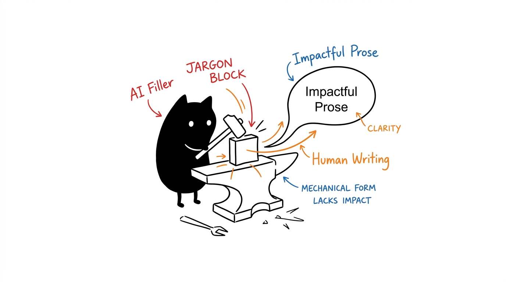
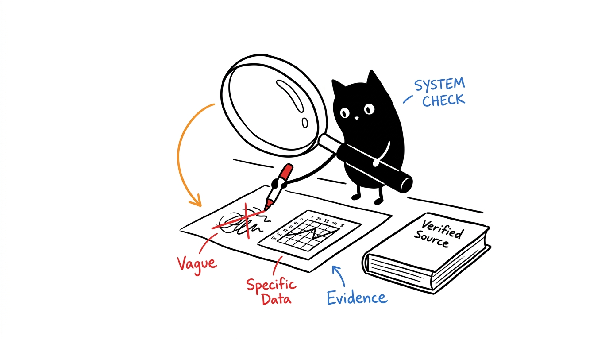
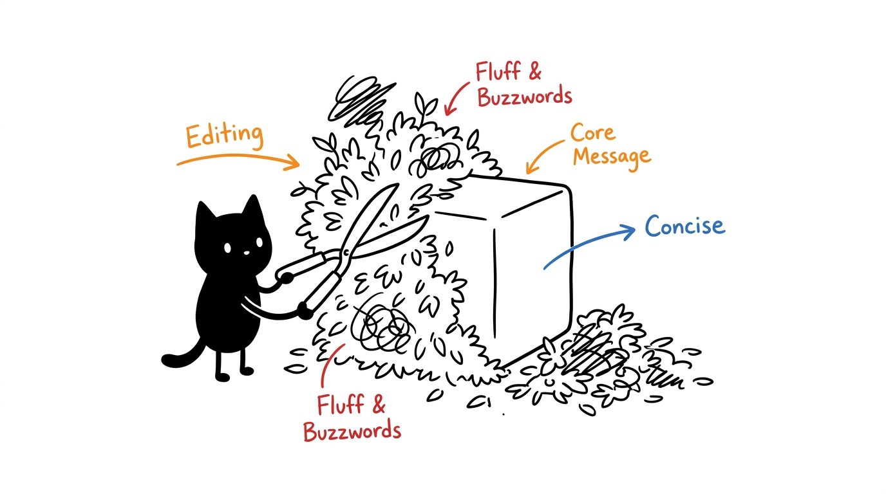

# Human Writing Skill



An agent skill for drafting and editing technical prose with less promotional filler and fewer mechanical patterns. It prioritizes factual accuracy, author intent, audience needs, and the conventions already used by the target project.

## What it covers



- READMEs and technical documentation
- Specifications, reports, and tutorials
- PR descriptions, release notes, and commit messages
- Code comments and technical explanations
- Rewriting that preserves claims, uncertainty, citations, and voice
- Context-sensitive review of repetitive or AI-sounding language

The skill treats common AI-writing patterns as editing signals, not proof of authorship or universal bans. It keeps valid terminology and natural structures when they are the clearest choice.

## Install

Clone the repository into your agent's skills directory. For clients that discover skills from `~/.agents/skills`:

```bash
git clone https://github.com/1999AZZAR/human-writing-skill.git ~/.agents/skills/human-writing
```

Other clients may use a different skills directory. Check the client's documentation, then restart or reload it so the new skill is discovered. Keep `SKILL.md` and `references/` together so the relative links resolve; `agents/openai.yaml` provides optional interface metadata for compatible clients.

## Use

Invoke the skill by name when the client supports explicit `$skill-name` syntax:

```text
Use $human-writing to rewrite this README for maintainers without changing its technical claims.
```

```text
Use $human-writing to review this release note for unsupported claims, vague language, and missing migration details.
```

The agent should inspect nearby documentation before editing. Project-specific conventions take precedence over the defaults in this repository.

If the client does not support explicit skill invocation, request the same behavior in plain language after confirming that it discovered the installed skill.

## Editing rules



The skill directs the agent to:

1. Identify the audience, purpose, source material, and required format.
2. Preserve facts, constraints, commitments, and uncertainty.
3. Prefer concrete wording and evidence-backed specificity.
4. Check formulaic patterns only when they reduce clarity or accuracy.
5. Verify the result for completeness, terminology, commands, links, and examples when possible.

It explicitly forbids inventing measurements, versions, citations, quotations, dates, benchmarks, or RFC applicability.

## Repository structure

```text
.
├── SKILL.md                  # Trigger metadata and operating workflow
├── README.md                 # Installation and usage
├── agents/openai.yaml        # Agent interface metadata
├── assets/icon.png           # Skill icon
└── references/
    ├── ai-tells.md           # Contextual formulaic-writing signals
    └── standards.md          # Positive professional-writing guidance
```

## Source note

The formulaic-writing reference is adapted in part from Wikipedia's community-maintained [Signs of AI writing](https://en.wikipedia.org/wiki/Wikipedia:Signs_of_AI_writing); its revision history identifies the contributors. Wikipedia text is available under the [Creative Commons Attribution-ShareAlike 4.0 License](https://creativecommons.org/licenses/by-sa/4.0/). Adapted material in `references/ai-tells.md` is distributed under the same license. The repository uses those observations as editorial heuristics, not as an AI-detection method.
